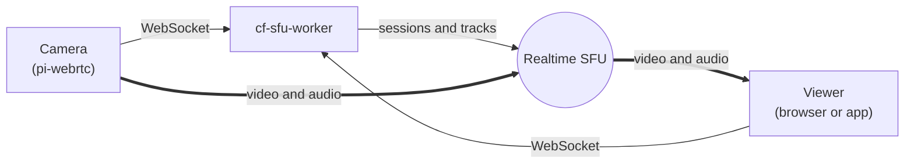

# cf-sfu-worker

[](https://github.com/mazupo/cf-sfu-worker/actions/workflows/ci.yml)
[](https://opensource.org/licenses/Apache-2.0)

## What is cf-sfu-worker?

A Cloudflare Worker that connects cameras to viewers through [Cloudflare Realtime SFU](https://developers.cloudflare.com/realtime/sfu/). A camera waits on a WebSocket and streams only while someone watches. A viewer joins a room and sees every camera in it.



## Features

- **Streams only when watched**: an idle camera sends only a small ping.
- **Rooms**: a viewer sees every camera in its room. A camera can be in up to 4 rooms.
- **Data channels**: send messages to a camera and back. One viewer at a time controls it.
- **Voice**: viewers talk to each other, and the cameras play their voices.
- **Survives reconnects and deploys**: streams keep going while a socket comes back.
- **Keeps your SFU token safe**: clients only get short access tokens.

## Quick Start

You need Node.js 22 or newer and a Cloudflare account.

```sh
git clone https://github.com/mazupo/cf-sfu-worker.git
cd cf-sfu-worker
npm install
npm run keys                      # prints a device key pair and a viewer key pair
cp .dev.vars.example .dev.vars    # then fill it in
npm run dev
```

In `.dev.vars`, set:

- `REALTIME_SFU_APP_ID` and `REALTIME_SFU_BEARER_TOKEN`: from **Realtime > SFU** in the Cloudflare dashboard.
- `DEVICE_PRIVATE_KEY` and `VIEWER_PRIVATE_KEY`: from `npm run keys`.

Then open two browser tabs:

1. [localhost:8787/cloudflare/device](http://localhost:8787/cloudflare/device): a camera simulator. Enter the device public key and a room. Click **Connect**.
2. [localhost:8787/cloudflare/](http://localhost:8787/cloudflare/): the viewer. Enter the viewer public key and the same room. Click **Join**.

Step by step: [Run it on your computer](docs/getting-started/local.md) · [Connect pi-webrtc](docs/getting-started/pi-webrtc.md)

## Deploy

[](https://deploy.workers.cloudflare.com/?url=https://github.com/mazupo/cf-sfu-worker)

Make your keys with `npm run keys` first. See [Deploy](docs/deployment/deploy.md).

## Clients

- [pi-webrtc](https://github.com/mazupo/pi-webrtc): streams a Raspberry Pi or Jetson camera.
- [@mazupo/client](https://github.com/mazupo/client-sdk-js): watch a room from a web or React Native app.

## Documentation

All guides are in [docs/](docs/README.md).

## License

Apache-2.0. See [LICENSE](LICENSE).
