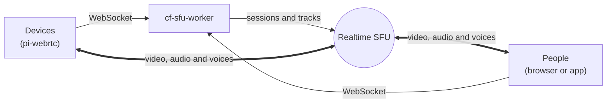

<h1 align="center">cf-sfu-worker</h1>

<p align="center">
    <a href="https://github.com/mazupo/cf-sfu-worker/actions/workflows/ci.yml"></a>
    <a href="https://developers.cloudflare.com/realtime/sfu/"></a>
    <a href="https://opensource.org/licenses/Apache-2.0"></a>
</p>

## What is cf-sfu-worker?

A Cloudflare Worker that lets a team work together with embedded devices that run [pi-webrtc](https://github.com/mazupo/pi-webrtc), such as a Raspberry Pi or a Jetson. Devices and people join rooms through [Cloudflare Realtime SFU](https://developers.cloudflare.com/realtime/sfu/). Everyone in a room sees every device and can talk, and one person at a time controls a device.



## Features

- **Shared rooms**: everyone in a room sees every device and talks by voice. A device can be in up to 4 rooms.
- **Remote control**: send commands and data to a device and back. One person controls it at a time; the others wait in line.
- **Streams only when watched**: an idle device sends only a small ping, so it costs almost nothing.
- **On your Cloudflare account**: deploy with one click. Your SFU secret stays in the worker; clients get short access tokens.

## Quick Start

You need Node.js 22 or newer and a Cloudflare account.

```sh
git clone https://github.com/mazupo/cf-sfu-worker.git
cd cf-sfu-worker
npm install
npm run keys                      # prints a device key pair and a viewer key pair
cp .dev.vars.example .dev.vars    # then fill it in
npm run dev
```

In `.dev.vars`, set:

- `REALTIME_SFU_APP_ID` and `REALTIME_SFU_BEARER_TOKEN`: from **Realtime > SFU** in the Cloudflare dashboard.
- `DEVICE_PRIVATE_KEY` and `VIEWER_PRIVATE_KEY`: from `npm run keys`.

Then open two browser tabs:

1. [localhost:8787/sfu/device](http://localhost:8787/sfu/device): a device simulator. Enter the device public key and a room. Click **Connect**.
2. [localhost:8787/sfu/](http://localhost:8787/sfu/): the viewer. Enter the viewer public key and the same room. Click **Join**.

Step by step: [Run it on your computer](docs/getting-started/local.md) · [Connect pi-webrtc](docs/getting-started/pi-webrtc.md)

## Deploy

[](https://deploy.workers.cloudflare.com/?url=https://github.com/mazupo/cf-sfu-worker)

Make your keys with `npm run keys` first. See [Deploy](docs/deployment/deploy.md).

## Clients

- [pi-webrtc](https://github.com/mazupo/pi-webrtc): runs on a Raspberry Pi or a Jetson and joins its rooms.
- [@mazupo/client](https://github.com/mazupo/client-sdk-js): watch a room from a web or React Native app.

## Documentation

All guides are in [docs/](docs/README.md).

## License

Apache-2.0. See [LICENSE](LICENSE).
