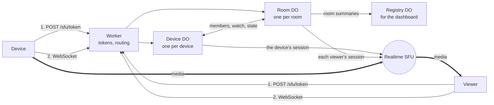
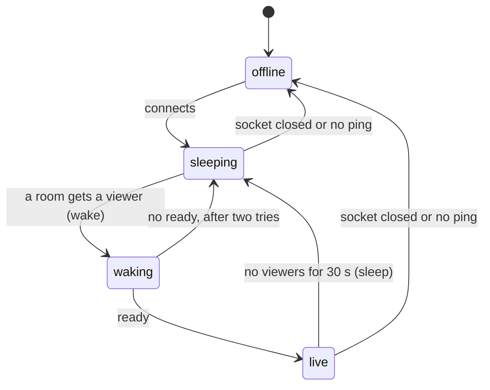
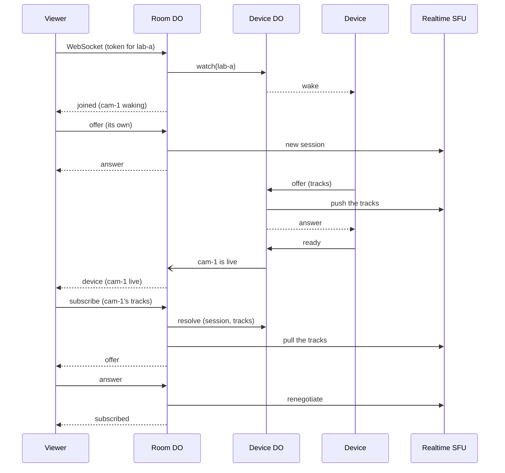

# Architecture

cf-sfu-worker is one Worker with three kinds of Durable Objects. This page shows what each part does, and what happens when someone watches a device.

## Parts

- **Worker** (`src/worker.ts`): gives out tokens, checks them, and sends each socket to its Durable Object. It also serves the pages.
- **Device** (`src/server/device.ts`): one per `device_id`. It holds the device's socket, its state, its SFU session, the rooms that watch it, and who controls it.
- **Room** (`src/server/room.ts`): one per `room_id`. It holds the viewers' sockets, each viewer's SFU session, what each viewer pulls, the member devices, and the microphones.
- **Registry** (`src/server/registry.ts`): one per worker. Each room reports to it, so the dashboard can list the rooms.

Each Durable Object keeps its state in its own SQLite storage. When two requests race, the object that owns the data decides. A restart or a deploy keeps the rooms, the viewers and the streams.

## Idle devices cost little

The sockets use the WebSocket Hibernation API. The runtime answers `ping` by itself, so an idle device does not wake its Durable Object. Alarms check the heartbeats: every minute while someone watches, and every 5 minutes for a device that nobody watches.

## Device states

A device that reconnects with the same secret and `generation` stays `live`. Its stream keeps going.

## Someone watches

The viewer's PeerConnection connects while the device wakes. So the video shows soon after the device is live.

## The last viewer leaves

1. The room tells the device that it no longer watches.
2. When no room watches, the device waits 30 seconds. A new viewer in that time cancels it.
3. The device gets `sleep` and closes its PeerConnection.

## Reconnects

| What happens | Result |
| --- | --- |
| A device reconnects with the same secret and `generation` | It keeps its stream. |
| A device's socket drops | It shows offline after 10 seconds, if it is not back. |
| A device's socket drops without a close | It leaves its rooms after 60 seconds. |
| A device closes its socket normally | It leaves its rooms at once. |
| A viewer reconnects within 30 seconds | It keeps its subscriptions and its control. |
| The worker is deployed | Every socket closes. Clients reconnect and keep their streams. |

## Code map

| Path | What it holds |
| --- | --- |
| `src/worker.ts` | The routes: token API, socket, dashboard, debug pages and pages |
| `src/server/token.ts` | The keys, and signing and checking tokens |
| `src/server/device.ts` | The Device Durable Object |
| `src/server/room.ts` | The Room Durable Object |
| `src/server/registry.ts` | The Registry Durable Object |
| `src/server/realtime.ts` | Calls to the SFU and TURN APIs |
| `src/server/socket.ts` | Reading and writing frames |
| `src/server/access.ts` | Checking Cloudflare Access sign-ins |
| `src/server/config.ts` | Settings and fixed timings |
| `src/shared/protocol.ts` | The token request rules and the paths |
| `demo/` | The scripts of the demo pages, bundled into `public/sfu/js` |
| `public/sfu/` | The demo pages and the dashboard |
| `tests/workerd/` | The tests |
| `external/protocol` | The protobuf messages (a git submodule) |
