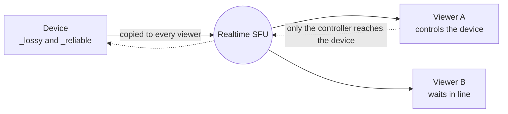

# Data channels

A device can open two data channels. The SFU copies what the device sends to every viewer that opens them. Only the viewer that controls the device can send back.

| Label | Ordered | Retransmits | Use |
| --- | --- | --- | --- |
| `_lossy` | no | 0 | Values you can drop, such as sensor readings |
| `_reliable` | yes | until it arrives | Commands |

Create each channel with `negotiated: true` and the `id` from the worker. The messages are `protocol.Packet` from `packet.proto`, with the text in `raw`.

## On the device

1. Before the offer, create a negotiated channel `server-events` with id 0.
2. Send the offer with `data_channels: true`.
3. Create `_lossy` and `_reliable` with the ids in `channels`.
4. `control` tells you who controls the device.

## On a viewer

The token request needs `data_channels: true`.

1. Send `subscribe` with `data: [device_id]`.
2. Send `take_control`. If someone else has control, you wait in line.
3. When `subscribed` shows `can_reply: true`, send `control_ready` within 5 seconds.
4. Send `release_control` to give up control, or your place in line.

Control belongs to the device, not to a room. A viewer in another room of the same device can take over. When a viewer goes away for more than 30 seconds, the next viewer in line gets control.
